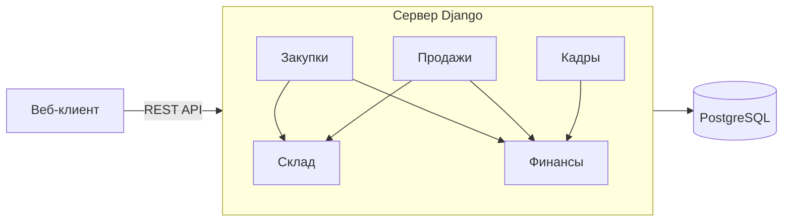

---
tags:
  - проектирование
---
# Архитектура системы

Основание: [[Требования к функциональности]]. Данные: [[Проектирование базы данных]].

Клиент-серверная система: веб-клиент через REST API обращается к серверному приложению, которое разделено на модули и работает с общей базой данных.

**Технологии:** React (клиент), Python и Django (сервер), PostgreSQL (база данных), Docker (развёртывание).

**Взаимодействие модулей:** Закупки и Продажи изменяют остатки через модуль Склад и передают суммы в Финансы; Кадры передают в Финансы начисленную зарплату.

